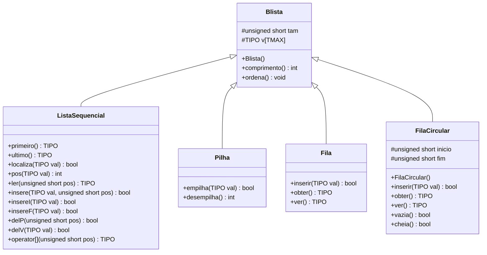

# Plano de Implementação: Exercícios de Listas Lineares (ex01 a ex09)

Este documento detalha o planejamento para a implementação dos exercícios de estruturas de dados lineares (Listas Sequenciais, Pilhas e Filas) identificados no material de aula [lista_Lineares.pdf](lista_Lineares.pdf) e nos arquivos base em [Algoritmos/](Algoritmos/).

---

## 1. Descrição do Objetivo

O objetivo deste projeto é fornecer implementações completas, robustas e documentadas para cada um dos exercícios propostos na disciplina de **Estruturas de Dados / Programação de Computadores II**.

Após a análise do PDF `lista_Lineares.pdf` e dos arquivos de código existentes em `./Algoritmos/`, foram identificados **9 exercícios** divididos entre a Lista Sequencial, Pilha e Fila Circular:

| Arquivo | Origem | Descrição do Exercício |
| :--- | :--- | :--- |
| `src/ex01.cpp` | `ListaSequencial.h` (L27) | Função externa/auxiliar para concatenar duas listas estáticas |
| `src/ex02.cpp` | `ListaSequencial.h` (L28) | Sobrecarga do operador `operator+` para concatenar duas listas |
| `src/ex03.cpp` | `ListaSequencial.h` (L29) | Método para inserir um vetor/array de números de uma só vez |
| `src/ex04.cpp` | `ListaSequencial.h` (L30) | Método para remover quaisquer valores de um intervalo definido de posições `[posIni, posFim]` |
| `src/ex05.cpp` | `ListaSequencial.h` (L31) | Método para determinar o maior valor contido na lista |
| `src/ex06.cpp` | `ListaSequencial.h` (L32) | Método para determinar o menor valor contido na lista |
| `src/ex07.cpp` | `ListaSequencial.h` (L33) | Método para retornar todos os valores que sejam maiores que um parâmetro |
| `src/ex08.cpp` | `Pilha.h` (L13) | Método para inverter a pilha |
| `src/ex09.cpp` | `lista_Lineares.pdf` (Slide 52) | Implementação da classe `FilaCircular` herdando de `Blista` |

Cada arquivo será implementado como um programa C++ independente com função `main()` contendo testes detalhados e saída formatada no terminal, respeitando rigorosamente a sintaxe e o estilo de codificação adotados pelo professor André Geraldo nos arquivos existentes (`Blista`, `TIPO`, `TMAX`, `tam`, `v`, tipos de dados e controle de limites).

---

## 2. Decisões de Projeto

> [!NOTE]
> **Exercício 4 (Remover em Intervalo de Posições):**
> Conforme definição, removeremos todos os elementos entre as posições `posIni` e `posFim` inclusive (ex: remover posições de 2 a 5). Os elementos posteriores são deslocados para a esquerda em bloco e o tamanho `tam` é decrementado de acordo com a quantidade de itens removidos.

> [!NOTE]
> **Estratégia de Inclusão e Compilação:**
> Para permitir que cada arquivo dentro de `src/` seja compilado de forma limpa e direta:
> - O código base em `Algoritmos/` será referenciado via `#include "../Algoritmos/ListaSequencial.h"` (ou `#include "../Algoritmos/Pilha.h"` / `blista.h`).
> - Forneceremos um `Makefile` na raiz do projeto com alvos individuais (`make ex01`, `make ex02`, etc.) e em lote (`make all`, `make run`), garantindo comodidade ao compilar e testar.

---

## 3. Arquitetura e Modelagem dos Exercícios



---

## 4. Detalhamento dos Arquivos Propostos

### Componente: `src/`

---

#### [NEW] `src/ex01.cpp` - Concatenação de Listas Estáticas (Função)
- **Objetivo:** Criar uma função independente que recebe duas listas sequenciais e retorna uma nova lista com a junção de ambas.
- **Assinatura:** `ListaSequencial concatena(const ListaSequencial& l1, const ListaSequencial& l2);`
- **Validação:** Checar se a soma dos comprimentos excede `TMAX`.
- **Casos de Teste no `main()`:**
  - Concatenação de duas listas com elementos normais.
  - Concatenação onde uma das listas está vazia.
  - Tentativa de concatenar listas cujo total ultrapassa `TMAX`.

```cpp
ListaSequencial concatena(const ListaSequencial& l1, const ListaSequencial& l2) {
    ListaSequencial resultado;
    for (int i = 0; i < l1.comprimento(); i++) {
        resultado.insereF(l1[i]);
    }
    for (int i = 0; i < l2.comprimento(); i++) {
        resultado.insereF(l2[i]);
    }
    return resultado;
}
```

---

#### [NEW] `src/ex02.cpp` - Sobrecarga do Operador `+`
- **Objetivo:** Permitir a sintaxe idiomática `l3 = l1 + l2;`.
- **Assinatura:**
  - Criar classe derivada `ListaSequencialEx : public ListaSequencial` contendo `ListaSequencialEx operator+(const ListaSequencialEx& outra) const`.
- **Casos de Teste no `main()`:**
  - `l3 = l1 + l2;`
  - Encadeamento: `l4 = l1 + l2 + l3;`

---

#### [NEW] `src/ex03.cpp` - Inserção de Vetor em Lote
- **Objetivo:** Inserir um array convencional de tamanho `n` de uma só vez na lista sequencial.
- **Assinatura:**
  - `bool insereVetor(const TIPO vet[], unsigned short n);` (insere ao final)
  - `bool insereVetor(const TIPO vet[], unsigned short n, unsigned short pos);` (insere em posição arbitrária com deslocamento em bloco)
- **Lógica:**
  - Testa `tam + n <= TMAX`.
  - Desloca elementos à direita em lote: `v[i + n] = v[i]`.
  - Copia os elementos e atualiza `tam += n`.

---

#### [NEW] `src/ex04.cpp` - Remoção de Valores em Intervalo de Posições
- **Objetivo:** Implementar método para remover elementos baseados em intervalo de posições `[posIni, posFim]`.
- **Implementação:**
  - `bool delIntervalo(unsigned short posIni, unsigned short posFim);`
- **Lógica:**
  - Valida se `posIni <= posFim && posFim < tam`.
  - Calcula a quantidade de elementos a remover: `qtd = posFim - posIni + 1`.
  - Desloca os elementos à esquerda: `for (int i = posIni; i < tam - qtd; i++) v[i] = v[i + qtd];`.
  - Atualiza `tam -= qtd`.
- **Casos de Teste no `main()`:**
  - Remover do índice 2 ao 4.
  - Remover do índice 0 ao 2.
  - Validação de intervalo inválido.

---

#### [NEW] `src/ex05.cpp` - Maior Valor da Lista
- **Objetivo:** Localizar e retornar o maior valor armazenado.
- **Assinatura:** `bool maior(TIPO& resultado);` e `TIPO maior();`
- **Lógica:**
  - Verifica lista vazia (`tam == 0`).
  - Inicializa `m = v[0]` e itera de 1 a `tam-1`.
  - Se `v[i] > m`, atualiza `m`.

---

#### [NEW] `src/ex06.cpp` - Menor Valor da Lista
- **Objetivo:** Localizar e retornar o menor valor armazenado.
- **Assinatura:** `bool menor(TIPO& resultado);` e `TIPO menor();`
- **Lógica:**
  - Análogo ao exercício 05, buscando o elemento com menor magnitude.
  - Tratamento para lista vazia, elementos negativos e duplicados.

---

#### [NEW] `src/ex07.cpp` - Filtrar Maiores que um Parâmetro
- **Objetivo:** Retornar uma nova lista contendo todos os elementos que satisfaçam a condição `elemento > parametro`.
- **Assinatura:** `ListaSequencial filtrarMaiores(TIPO parametro);`
- **Lógica:**
  - Cria lista resultado vazia.
  - Itera `for (unsigned short i = 0; i < tam; i++)`.
  - Se `v[i] > parametro`, insere em resultado com `insereF(v[i])`.

---

#### [NEW] `src/ex08.cpp` - Inverter a Pilha
- **Objetivo:** Inverter a ordem dos elementos contidos em uma `Pilha`.
- **Abordagens demonstradas:**
  1. **Abordagem In-Place (Acesso interno):** Como `v` e `tam` são protegidos em `Blista`, inverte o vetor `v` trocando `v[i]` com `v[tam - 1 - i]`.
  2. **Abordagem Clássica via TAD:** Desempilha todos os itens em uma `Fila` auxiliar e reinsere na pilha, ilustrando o uso conceitual das estruturas LIFO e FIFO aprendidas na disciplina.
- **Casos de Teste no `main()`:**
  - Empilhar $\{1, 2, 3, 4, 5\}$, inverter, e desempilhar demonstrando a ordem invertida $\{1, 2, 3, 4, 5\}$.

---

#### [NEW] `src/ex09.cpp` - Fila Circular (Slide 52)
- **Objetivo:** Implementar a classe `FilaCircular` herdada de `Blista` conforme solicitado no slide 52 de `lista_Lineares.pdf`.
- **Destaques de Engenharia e Complexidade:**
  - Resolução do problema apontado no Slide 46 (*"O processo de obtenção de elementos na fila pode ser lento? Sim, pois envolve mover todos elementos"*).
  - Em `FilaCircular`, tanto `inserir` quanto `obter` operam em tempo constante $O(1)$.
- **Atributos:**
  - `unsigned short inicio;`
  - `unsigned short fim;`
  - `tam;` (já presente em `Blista`)
- **Métodos:**
  - `bool inserir(TIPO val);` (avança `fim = (fim + 1) % TMAX`)
  - `TIPO obter();` (avança `inicio = (inicio + 1) % TMAX`)
  - `TIPO ver();` (inspeciona `v[inicio]`)
  - `bool vazia();` e `bool cheia();`
- **Casos de Teste no `main()`:**
  - Inserção até preencher parcialmente.
  - Remoções sucessivas para avançar o ponteiro de início.
  - Inserções adicionais forçando o ponteiro de fim a dar a "volta" circular no vetor.
  - Verificação de preservação dos dados e comportamento FIFO.

---

### Componente: Automação de Build

---

#### [NEW] `Makefile`
- **Objetivo:** Automatizar a compilação individual e em lote com `g++ -Wall -std=c++11 -IAlgoritmos`.
- **Targets:**
  - `make all`: Compila todos os 9 executáveis para a pasta `bin/`.
  - `make ex01`, `make ex02`, ..., `make ex09`: Compila um exercício específico.
  - `make run`: Executa todos os testes em sequência.
  - `make clean`: Remove os binários gerados.

---

## 5. Plano de Verificação

### Testes Automatizados de Compilação
Compilar cada arquivo individualmente e em lote verificando ausência de warnings e erros:
```bash
make clean && make all
```

### Testes de Execução
Executar cada programa e validar a saída esperada:
```bash
./bin/ex01
./bin/ex02
./bin/ex03
./bin/ex04
./bin/ex05
./bin/ex06
./bin/ex07
./bin/ex08
./bin/ex09
```

